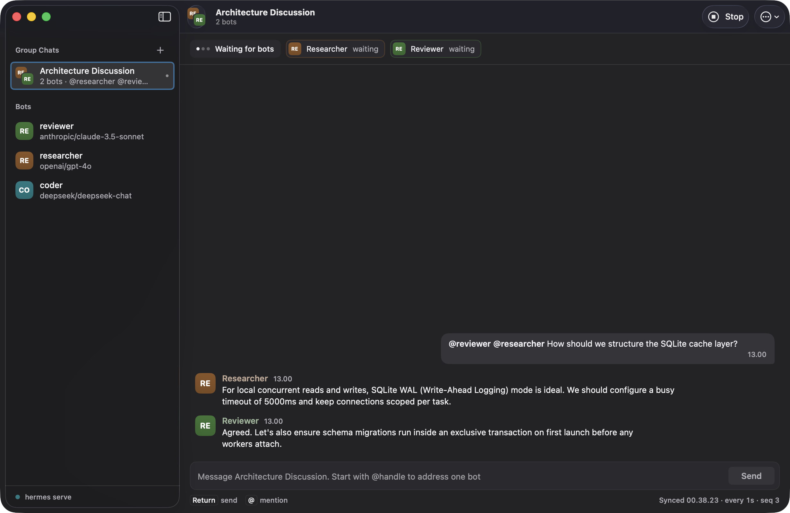
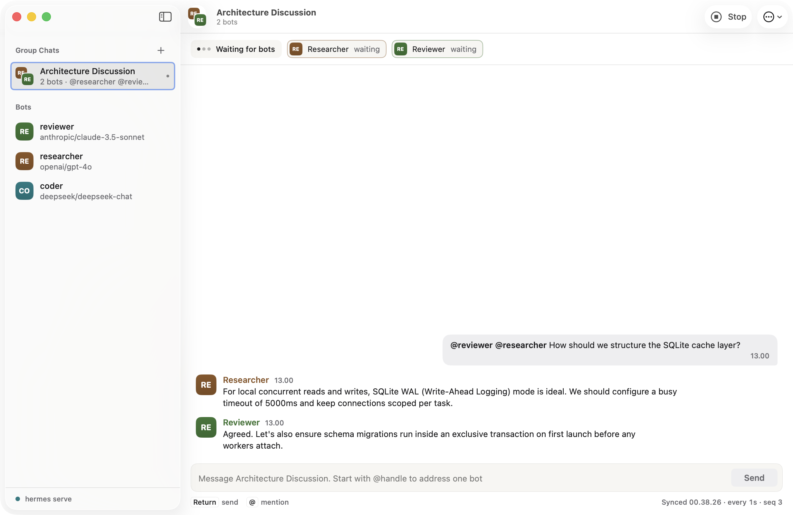

# Hermes Bot for macOS

A lightweight native macOS (SwiftUI) client for [Hermes Agent](https://github.com/NousResearch/hermes-agent),
focused on three things: **Bots**, **Bot Chat** (1:1, streaming) and **Group Chat** (2–6 bots in one room).

It is a thin client: all agent logic runs in the Hermes backend (`hermes serve`). The app talks to it over
the gateway WebSocket (JSON-RPC) and does not reimplement any agent behavior.

> **Independent project.** Not affiliated with or endorsed by Nous Research. "Hermes" refers to the
> Hermes Agent backend this app connects to.

**Status: early / pre-release.** Build from source, or download an ad-hoc signed (not notarized) zip from
[GitHub Releases](https://github.com/risyadul/HermesBotDesktop/releases); see [Download / packaging](#download--packaging).

<p align="center">
  
  <br>
  <em>Native app with demo/mock data (Group Chat in Dark Mode)</em>
</p>
<details>
<summary>View Light Mode screenshot</summary>
<p align="center">
  
  <br>
  <em>Native app with demo/mock data (Group Chat in Light Mode)</em>
</p>
</details>

## Before you start: what this app does to your Hermes data

- **It uses your real Hermes install (`~/.hermes`).** If a Hermes backend is already running (for example the
  Hermes desktop app), this app attaches to it. Otherwise it starts its own `hermes serve` on `~/.hermes` and
  stops it when you quit. A backend it attached to is never stopped. To keep rooms and routines running after
  you quit, turn on **Keep Hermes running in the background** in Settings (see
  [Keeping Hermes running](#keeping-hermes-running)).
- **Bot Chat is the same chat Hermes Desktop uses for that bot.** Opening a bot continues its existing
  history; the app never deletes it. Quitting only disconnects. If the app cannot confirm whether the chat
  exists, it does not start a new one. If the chat is running in another Hermes app (error 4090), the app
  says so; open it in that app.
- **Group Chat rooms are separate from the Hermes desktop app's group chats.** Rooms here are the backend's
  hosted rooms (`groups.*`); group chats you made in the Electron app will not show up, and vice versa.
- **It does not change your profiles or bot config**, with one opt-in exception: if you turn on activity
  tracking in a Group Chat, the app installs the open-source
  [Bot Activity](https://github.com/risyadul/hermes-bot-activity) plugin (a pinned commit) into Hermes and
  enables it for every bot. Turning it off from the same panel disables it in every bot profile and removes it
  from Hermes; the bots' copies stay on disk, inactive. Bots are your existing Hermes profiles.
- **Kanban edits are real.** Cards you create, move, assign or archive in the Kanban view change your Hermes
  Kanban board, the same one Hermes Desktop and the `hermes kanban` CLI use.
- **It only connects to backends on loopback** (`127.0.0.1`, `::1`, `localhost`); a backend record pointing
  elsewhere is rejected.
- Setting `HERMES_HOME` does **not** isolate the app today; it always uses `~/.hermes`.

## Requirements

| | |
|---|---|
| macOS | 14 or later (Apple Silicon tested; Intel untested) |
| Toolchain | Xcode 26 / Swift 6.3 (tested). Command Line Tools only: **untested** |
| Hermes Agent | installed and configured with a model provider (see below) |
| `hermes` binary | found automatically: `~/.local/bin/hermes`, the `$PATH` of the process that launched the app, then `/opt/homebrew/bin` and `/usr/local/bin`. `HERMES_BOT_APP_HERMES_BIN` (an absolute path) replaces that search. It must be a regular executable file, not group/world-writable, in a directory that is not group/world-writable (unless sticky) |

Hermes Agent compatibility: tested only against a Hermes Agent `main` build (`v0.21.6+783.g8a7a5a9`).
The `groups.*` API this app needs is present in stable `v2026.9.14` and later, but stable releases
have **not been tested** with this app yet.

## Quick start

> ⚠️ Verified: clean-clone build (`swift build`). **Not yet verified end to end** (fresh Hermes install →
> first reply in Bot Chat and Group Chat) on a clean machine. Report anything that does not work.

1. **Install and set up Hermes Agent** by following the
   [Hermes Agent docs](https://hermes-agent.nousresearch.com/docs), then configure a model provider
   (`hermes setup` or `hermes model`). Check that a plain chat works in Hermes itself first.
2. **Have at least two bots (for Group Chat).** Each Hermes profile is a bot; `default` counts as one. Create
   another and give it its own provider config:
   ```sh
   hermes profile create reviewer
   hermes -p reviewer setup        # or: hermes -p reviewer model
   ```
   `hermes profile create reviewer --clone` also works but copies the active profile's `config.yaml` **and `.env`
   (credentials)** into the new profile; only use it if that is what you want.
   Bot Chat alone works with a single profile.
3. **(Optional) Point the app at a specific `hermes` binary.** The app looks in `~/.local/bin`, on the
   `$PATH` of the process that launched it, and in the Homebrew locations. A terminal launch inherits your
   shell's `$PATH`; an app opened from Finder gets launchd's minimal `$PATH` (`/usr/bin:/bin:/usr/sbin:/sbin`),
   so there only the fixed locations (`~/.local/bin`, `/opt/homebrew/bin`, `/usr/local/bin`) find it. If yours
   lives elsewhere (pipx, venv, …), set an absolute path; it replaces the search (nothing else is tried):
   ```sh
   export HERMES_BOT_APP_HERMES_BIN="$(which hermes)"
   ```
4. **Build and run:**
   ```sh
   git clone https://github.com/risyadul/HermesBotDesktop.git
   cd HermesBotDesktop
   swift build
   .build/debug/HermesBotApp        # or: swift run HermesBotApp (the package has several executables)
   ```
5. **First chat:** pick a bot in the sidebar and send a message. For Group Chat, press **+**, choose 2–6
   bots, and send the opening message.
6. **Quit** with ⌘Q, by closing the window, or with Ctrl+C in the terminal you launched it from. All three
   run the same cleanup (see the data section above). Force-killing the app (`kill -9`) skips it.

## Using Bot Chat

- **Slash commands:** type `/` for the commands your bot offers (including skills); ↑/↓ move, Tab or Return
  accepts, Esc closes. `/new`, `/reset` and `/clear` compact the conversation instead of resetting it;
  `/compress` and `/stop` work. Commands that only make sense in Hermes Desktop or the terminal are not offered.
- **Tool activity:** each tool a bot uses shows as a line that ends with its duration and result summary, or
  is marked failed.
- **Bots asking you things:** approval requests (once, for the session, always, or deny), clarifying questions
  and password/secret prompts appear as cards above the composer. Requests the app cannot show are left for
  other Hermes apps to answer.
- **Attachments:** paperclip, drag and drop, or paste. Images (up to 25 MB), PDFs (up to 50 MB and 25 pages;
  needs `pdftoppm` on the backend machine) and other files. Files over a limit are refused with a message.
- **Files from bots:** images show inline and other files as chips (Bot Chat and Group Chat). A file opens
  only when you click it, after a safety check that refuses credentials and system locations.
- **Files in Group Chat:** the backend's group rooms accept only text, so a file you attach (paperclip, ⌘V or
  drag and drop, up to 10 files of 50 MB each) is copied to
  `~/Library/Application Support/HermesBotApp/Room Attachments/<room>/` and the message names the copies'
  paths; the room's bots open them with their file tools. This app shows them as attachments; Hermes Desktop
  shows the paths as text. The copies are deleted when you disband the room.

## Group Chat activity

Bots in a Group Chat work in hidden sessions, so the room itself only shows when each bot starts, replies or
passes. The **Activity** panel (toolbar button, ⌥⌘I) shows, per bot, what it is doing right now: the tool it
is running and for how long, its recent tool calls with arguments and results, its reasoning, and errors. The
bot's turn status (for example "needs approval") stays next to its live status. The panel stops polling while
its window is covered or the app is hidden, and picks up again when it is back.

The detailed view needs the [Bot Activity](https://github.com/risyadul/hermes-bot-activity) Hermes plugin,
because Hermes hands those events only to plugins. If it is not installed, the panel shows each bot's turn
status, a **This round** list of the latest round from the room log (queued, working, replied, passed, timed
out, failed, needs approval; newest first), and an **Enable Tracking…** button. Enable installs a pinned commit
of the plugin, turns it back on in any bot profile where it is disabled, and enables it for every bot. A copy
that is already installed but disabled is turned on only if Hermes's install record pins it to that same
commit; otherwise the panel says the installed copy isn't the reviewed version and offers **Reinstall Pinned
Version…**, which replaces it with the pinned commit. Enabling and turning off run once for the whole app: a
second Group Chat that asks for the same thing while it runs waits for it and shows the same progress; a
different action is refused until the running one finishes (its buttons are disabled meanwhile).

**Turn Off Activity Tracking…** in the panel's … menu disables the plugin in every bot profile
(`hermes -p <bot> plugins disable bot-activity`), then removes the copy in Hermes's own plugins folder. The bots'
copies stay on disk but inactive; **Enable Tracking…** turns them back on. If some bots can't be switched off,
the panel names them.

## Kanban

The **Boards** section in the sidebar shows your Hermes Kanban boards (the built-in `kanban` plugin). You can
see the columns and cards, open a card for its description, summary, dependencies, attachments, comments and
worker log, and create, move, assign, prioritize, comment on and archive cards.

- **Attachments:** attach files to a card with the paperclip or by dropping them on its Attachments list (up to
  25 MB each, the server's limit), open them, or delete them. Opening downloads a copy into the app's caches
  folder; documents open in their usual app, while apps, scripts, installers, web pages and archives are only
  shown in Finder, never run.
- **Message the running worker:** on a running card the comment box sends your note to the worker, which picks
  it up in its current turn within a few seconds. **Requeue with note** posts the note and restarts the task
  from scratch with it.

- **Boards that go away:** if a board is deleted or archived while you have it open, it says so, stops
  refreshing and refuses changes; **Go to Another Board** opens one that still exists. It also leaves the
  sidebar at the next board list refresh.
- **Long texts:** descriptions, summaries, results and comments longer than 64,000 characters show their
  first 64,000 characters with a note.
- **Refreshing:** the open board, the board list and the dispatcher status refresh only while an app window is
  on screen; they pause while the app is hidden or its windows are minimised or covered, and catch up when
  you come back.
- If the sidebar says **Boards unavailable on this connection**, the connected Hermes gave the app no REST
  access, which Kanban needs.

Cards are worked on by the Kanban dispatcher, which runs inside `hermes gateway`, not inside this app. The
board header and **Settings → Kanban dispatcher** show the same status. If it is installed but stopped,
**Start** runs `hermes gateway start`; if it is not installed, run `hermes gateway install` once.

## Keeping Hermes running

When this app starts its own backend, quitting the app stops it, and with it any Group Chat round in progress
and the scheduler for routines. **Settings → Keep Hermes running in the background** installs a per-user
LaunchAgent (`~/Library/LaunchAgents/io.github.risyadul.hermesbot.serve.plist`) that starts `hermes serve` at
login and restarts it if it crashes; the app then attaches to it. It is off by default. Its log is
`~/Library/Logs/HermesBotApp/background-serve.log`.

- Turning it on asks first and shows the `hermes` executable launchd will run. If that path comes from
  `HERMES_BOT_APP_HERMES_BIN` rather than the usual search, the question says so; it keeps running after the
  app quits, so make sure you trust it.
- If the app is running its own backend at that moment, you choose: **Switch Now** stops the app's backend
  (a Group Chat round in progress stops), starts the background Hermes and reconnects to it; **At Next
  Launch** only installs the LaunchAgent, and the background Hermes starts the next time you open the app (or
  at login). Two backends never run side by side.
- Turning it off unloads and deletes the LaunchAgent, which stops that Hermes. If the app is connected to it,
  it asks first (the connection drops and a Group Chat round in progress stops), then reconnects, starting its
  own backend if no other Hermes is running.
- **Installed but not running** (launchd does not have it) and **Loaded but not running** (launchd has it, but
  Hermes exited or is waiting after a crash; see the log): **Start** starts the installed agent as it is. If
  it shows **Hermes not found** (for example after moving or reinstalling Hermes), **Reinstall** rewrites it
  with the current `hermes` path, after the same question as turning it on.
- The log folder is readable by you only (0700) and the log file is created 0600.

## Configuration

| Variable | Effect |
|---|---|
| `HERMES_BOT_APP_HERMES_BIN=<path>` | `hermes` executable used when the app has to start a backend. Absolute path (or `~/…`); replaces the automatic search |
| `HERMES_BOT_APP_NO_SPAWN=1` | only attach to a running backend; never start one |
| `HERMES_BOT_APP_APPEARANCE=light\|dark` | force appearance |

Developer/test variables are listed in [docs/development.md](docs/development.md).

## Troubleshooting

> ⚠️ Failure messages below are not yet verified on a clean machine.

- **Backend does not start:** check `~/Library/Logs/HermesBotApp/serve.log` (the error message names it);
  usually the `hermes` path (quick start step 3) or a missing provider config (step 1).
- **"hermes not found":** set `HERMES_BOT_APP_HERMES_BIN` to the full path of the binary.
- **Bots list is empty / Group Chat needs more bots:** see quick start step 2.
- **"Group Chat needs Hermes Agent v2026.9.14 or later":** the backend does not offer `groups.*`; update
  Hermes Agent. The "+" button stays disabled until then.
- **Connection lost:** the app shows a failure screen; press Try Again to reconnect.
- **My Bot Chat history looks short or empty:** Bot Chat is the bot's one chat titled "Bot Chat" and is never
  deleted by this app. `/new`, `/reset` and `/clear` compact it rather than reset it. If the app cannot find or
  confirm the chat it shows an error instead of starting a new one; press Try Again.
- **"Running in another Hermes app":** another backend process holds that bot's chat. Use it in that app.
- **PDF attachment fails:** PDFs are rendered with `pdftoppm` on the backend machine; install it (poppler).

## Download / packaging

Tagged releases attach `HermesBot-<version>-macos-arm64.zip` on
[GitHub Releases](https://github.com/risyadul/HermesBotDesktop/releases). To build the same bundle yourself:

```sh
scripts/package-app.sh [version]    # writes dist/HermesBot.app and dist/HermesBot-<version>-macos-arm64.zip
```

The app is **ad-hoc signed, not notarized** (no Developer ID). On first launch macOS will refuse it:
right-click the app and choose **Open**, or run `xattr -dr com.apple.quarantine HermesBot.app`. These
packages have only been checked to build, sign and lint; launching them on a clean machine is untested.

## Known limitations

- macOS only; release builds are ad-hoc signed, not notarized.
- Group Chat follows rooms by polling (the backend has no push for rooms yet).
- No isolated mode for end users; always uses `~/.hermes`.

## Roadmap

Planned work, phased and tracked as a checklist: [docs/roadmap.md](docs/roadmap.md).

## Contributing

See [CONTRIBUTING.md](CONTRIBUTING.md) and [docs/development.md](docs/development.md) for layout, tests (`swift test`, no live backend needed),
harness CLIs and protocol notes ([gateway contract](docs/gateway-contract.md),
[groups contract](docs/groups-contract.md)).

Security issues: please report privately, see [SECURITY.md](SECURITY.md). Please follow the
[Code of Conduct](CODE_OF_CONDUCT.md). Changes are listed in the [CHANGELOG](CHANGELOG.md).

## License

Licensed under the [Apache License, Version 2.0](LICENSE).

Unless you explicitly state otherwise, any contribution you intentionally submit for inclusion in this
project is licensed under the same terms, without any additional terms or conditions.
